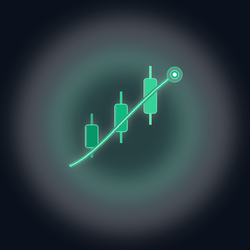
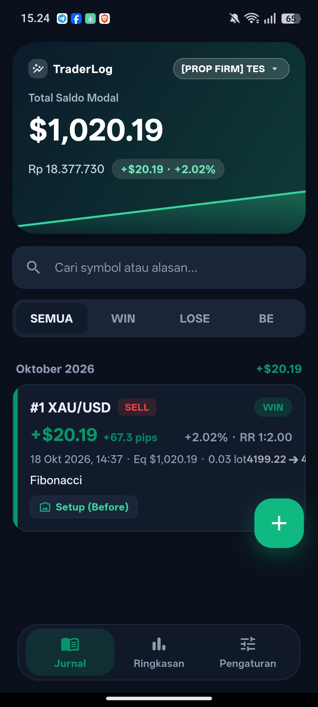
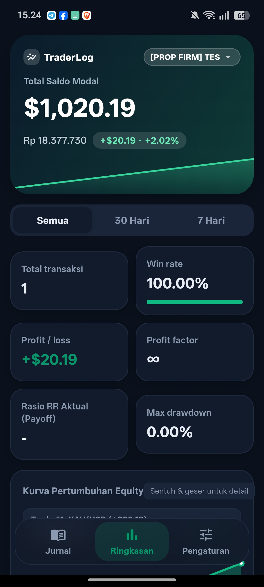
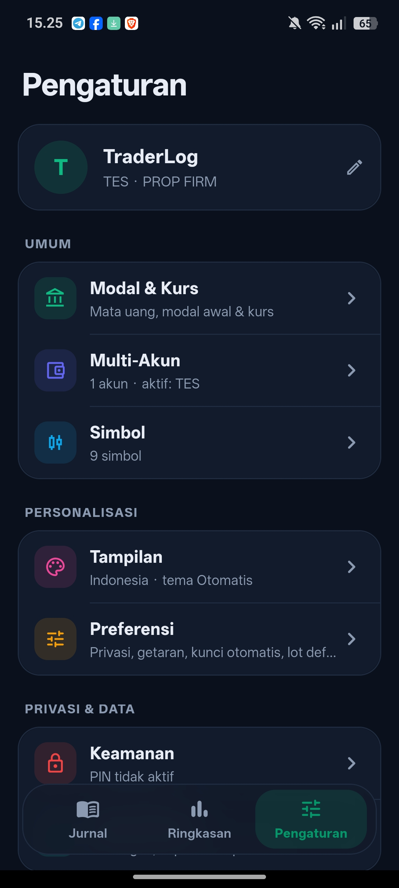

<p align="center">
  
</p>

<h1 align="center">TraderLog</h1>

<p align="center">
  <strong>Jurnal Trading Android Profesional, Cepat, Offline-First & Pelacak Kinerja Kuantitatif</strong>
</p>

<p align="center">
  <a href="https://github.com/zacxyonly/traderlog/releases/latest">
    
  </a>
  <a href="https://flutter.dev">
    
  </a>
  <a href="https://www.android.com">
    
  </a>
  <a href="https://sqlite.org">
    
  </a>
  <a href="LICENSE">
    
  </a>
</p>

<p align="center">
  <a href="https://github.com/zacxyonly/traderlog/actions/workflows/build_apk.yml">
    
  </a>
  <a href="https://sociabuzz.com/zacxyonly/tribe">
    
  </a>
</p>

<p align="center">
  🌐 <strong>Pilihan Bahasa:</strong>
  <strong>Bahasa Indonesia 🇮🇩</strong> | <a href="README.md">English 🇬🇧</a>
</p>

---

## 📖 Ringkasan

**TraderLog** adalah aplikasi jurnal trading Android berkecepatan tinggi yang dirancang khusus untuk trader Forex, Komoditas (Gold/XAUUSD), Saham, Indeks, dan Crypto yang mengutamakan disiplin psikologi serta pembuktian statistik atas trading rule mereka.

Dibangun dengan arsitektur modern **Flutter** dan penyimpanan lokal **SQLite (SQFlite)**, TraderLog menjamin kerahasiaan 100% data akun dan transaksi Anda: **tanpa cloud tracking pihak ketiga, tanpa registrasi akun wajib, arsitektur offline-first, dan kendali data penuh di tangan Anda**.

---

## 🌟 Fitur Unggulan

### 1. 📊 Analisis & Evaluasi (Tab Ringkasan)
* **📈 Grafik Equity Curve Interaktif**: Visualisasi garis pertumbuhan modal akumulatif yang dinamis dengan baseline modal awal, penanda titik tertinggi (*All-Time Peak*), garis *scrub* sentuh real-time, dan tooltip info PnL per trade.
* **🎯 Metrik Inti Kuantitatif Otomatis**:
  - **Win Rate (%)** & Rasio Menang/Kalah/BE.
  - **Profit Factor (PF)** (Gross Profit / Gross Loss).
  - **Rata-rata R:R Aktual (Payoff Ratio)** (Rata-rata profit transaksi menang dibanding rata-rata loss transaksi kalah).
  - **Max Drawdown** (Penurunan saldo terdalam dari puncak, ditampilkan dalam % dan nominal mata uang).
* **🗓️ Kalender PnL (Heatmap)**: Tampilan kisi kalender bulanan berwarna hijau (*Green Day / Profit*) dan merah (*Red Day / Loss*) per tanggal untuk memantau konsistensi harian secara visual. Dilengkapi bar ringkasan bulanan dan *bottom sheet* detail transaksi saat tanggal disentuh.

### 2. 📝 Optimalisasi Form Pencatatan (Tab Jurnal)
* **📸 Dua Slot Gambar (Before & After)**: Memisahkan foto analisis sebelum entry (*Setup*) dan sesudah trade selesai (*Outcome / Evaluasi Reaksi Harga*) untuk review trading yang objektif dan mendalam.
* **🏷️ Tag Cepat Setup & Emosi (Chips)**: Tombol pilihan sekali-klik untuk konfirmasi teknikal (*BOS, CHOCH, FVG, Liquidity, Breakout, SnR, Trendline*) serta kondisi psikologi trader (*Disiplin, FOMO, Revenge Trade, Overlot, Early Exit, Overtrading*).
* **🧮 Kalkulator PnL & Nilai Pip Otomatis**: Tombol kalkulator bantu untuk menghitung estimasi pip selisih harga dan profit/loss berdasarkan instrumen (Forex USD-quote, Gold/XAU, Crypto/Index), posisi (Buy/Sell), lot size, entry, dan exit/TP/SL, lengkap dengan tombol 1-klik untuk memasukkan hasil langsung ke form.

### 3. 🛡️ Portofolio, Multi-Akun & Keamanan (Tab Atur)
* **👥 Multi-Akun (Switcher)**: Kemampuan memisahkan catatan transaksi antara akun **Real**, **Demo**, dan **Evaluasi / Prop Firm**, atau membuat akun kustom dengan modal awal independen. Dilengkapi *switcher* 1-tap di kartu saldo utama maupun di pengaturan.
* **🔐 Kunci Biometrik & PIN 4-Digit Salted SHA-256**: Pengamanan layar pembuka (*SecurityLockScreen*) dengan 4-digit PIN yang disimpan menggunakan algoritma hash *iterated salted* HMAC-SHA256 (melalui `PinHasher`) serta sensor sidik jari perangkat via `local_auth`.
* **📦 Cadangan & Pemulihan Lengkap (ZIP)**: Satu file ZIP utuh berisi semua transaksi, screenshot chart analisis, data akun, dan preferensi pengaturan. Simpan langsung ke penyimpanan internal atau unggah ke **Google Drive**.
* **💱 Kurs Otomatis & Multi-Currency**: Dukungan mata uang akun (USD, IDR, USDC, USDT, EUR, GBP, JPY, SGD, AUD) serta sinkronisasi kurs live otomatis via open FX market API.
* **🌐 Bilingual Lengkap (ID & EN)**: Beralih instan antara Bahasa Indonesia 🇮🇩 dan English 🇬🇧 di seluruh menu, grafik, kalender, dan pesan dialog.

## 📱 Tangkapan Layar Aplikasi

| 📱 Jurnal Transaksi | 📊 Ringkasan Performa | ⚙️ Pengaturan & Portofolio |
| :---: | :---: | :---: |
|  |  |  |
| *Kartu Saldo, Tag Emosi & Histori Trade* | *Grafik Equity Curve & Kalender PnL* | *Multi-Akun Portofolio & Kunci PIN* |

---

## 🛠️ Arsitektur & Teknologi

TraderLog dibangun menggunakan teknologi dan pustaka terbaik dalam ekosistem Flutter:

- **Framework**: [Flutter](https://flutter.dev) (v3.24.5 - Channel Stable)
- **Bahasa Pemrograman**: [Dart](https://dart.dev) (v3.5.4)
- **Local Database**: [sqflite](https://pub.dev/packages/sqflite) dengan engine SQLite native & sistem migrasi tabel
- **Keamanan & Kriptografi**: [crypto](https://pub.dev/packages/crypto) (Salted HMAC-SHA256 hashing) & [local_auth](https://pub.dev/packages/local_auth) (Sidik Jari / Biometrik Android)
- **State Management**: [provider](https://pub.dev/packages/provider) (Arsitektur reaktif)
- **Manajemen Arsip ZIP**: [archive](https://pub.dev/packages/archive) (Kompresi & ekstraksi cadangan utuh)
- **File System & Sharing**: [share_plus](https://pub.dev/packages/share_plus) & [file_picker](https://pub.dev/packages/file_picker)
- **Media Capture**: [image_picker](https://pub.dev/packages/image_picker)
- **CI / CD Pipeline**: GitHub Actions (`workflow_dispatch` dengan verifikasi keystore rilis otomatis)

---

## 📂 Struktur Direktori Proyek

```plaintext
traderlog/
├── .github/
│   └── workflows/
│       └── build_apk.yml          # Otomasi kompilasi APK rilis via GitHub Actions (Manual)
├── android/                       # Konfigurasi native Android, Manifest, & Icon
│   └── app/src/main/res/
│       ├── icon_512.png           # Master artwork ikon resolusi tinggi
│       └── mipmap-*/              # Adaptive launcher icon untuk perangkat
├── assets/
│   └── icon/                      # Aset ikon aplikasi
├── docs/
│   └── screenshots/               # Tangkapan layar antarmuka aplikasi (Jurnal, Ringkasan, Atur)
├── lib/
│   ├── constants/
│   │   └── app_colors.dart        # Palet warna primer (Emerald, Navy, Wine Red, Amber)
│   ├── database/
│   │   └── db_helper.dart         # Skema SQLite & transaksi database
│   ├── models/
│   │   ├── app_settings.dart      # Model pengaturan akun, PIN hash, biometrik, kurs, & tema
│   │   ├── trade.dart             # Model data transaksi, foto before/after, & rasio RR
│   │   └── trading_account.dart   # Model multi-akun portofolio (Real, Demo, Prop Firm)
│   ├── providers/
│   │   └── trade_provider.dart    # Controller transaksi, kalkulasi kurva equity, & auth lock
│   ├── screens/
│   │   ├── journal_screen.dart    # Jurnal transaksi bulanan, filter emosi/setup & pencarian
│   │   ├── main_navigation_screen.dart # Navigasi melayang dengan blur effect & Quick FAB
│   │   ├── security_lock_screen.dart # Layar pembuka PIN 4-digit & autentikasi sidik jari
│   │   ├── settings_screen.dart   # Pengaturan 6 kategori (Profil, Akun, Keamanan, Tampilan, Data)
│   │   ├── summary_screen.dart    # Dashboard ringkasan: Equity Curve, Heatmap Kalender & Metrik
│   │   └── trade_form_sheet.dart  # Form input trade: Slot Before/After, Chip emosi, & Kalkulator PnL
│   ├── services/
│   │   ├── backup_service.dart    # Layanan pencadangan & pemulihan arsip ZIP lengkap
│   │   ├── csv_service.dart       # Algoritma parser CSV, validasi data & deteksi duplikat
│   │   └── currency_service.dart  # Integrasi kurs live otomatis multi-currency
│   ├── utils/
│   │   ├── app_strings.dart       # Kamus lokalisasi dwibahasa (Indonesian & English)
│   │   ├── formatters.dart        # Formatting mata uang, persentase, desimal & tanggal
│   │   ├── pin_hasher.dart        # Enkripsi & verifikasi PIN berbasis salted HMAC-SHA256
│   │   └── pnl_calculator.dart    # Mesin kalkulasi presisi PnL dan selisih pips
│   ├── widgets/
│   │   ├── account_switcher_sheet.dart # Modal switcher akun real, demo, dan prop firm
│   │   ├── equity_sparkline.dart  # Grafik sparkline ringkas
│   │   ├── hero_summary_card.dart # Kartu hero saldo total akun & badge active account
│   │   ├── image_viewer_dialog.dart # Modal preview screenshot chart interaktif (zoom & pan)
│   │   ├── interactive_equity_curve.dart # Grafik equity interaktif dengan scrub & peak marker
│   │   ├── pnl_calendar_heatmap.dart # Kalender visual PnL bulanan (Green/Red days)
│   │   ├── stat_card.dart         # Komponen metrik ringkasan kartu statistik
│   │   ├── trade_card.dart        # Komponen kartu histori trade & Before/After chips
│   │   └── trade_detail_sheet.dart # Modal inspeksi detail mendalam per transaksi
│   └── main.dart                  # Entry point aplikasi Flutter, Lock check & MultiProvider
├── test/
│   ├── backup_service_test.dart   # Unit test pembuatan, verifikasi & pemulihan arsip ZIP
│   ├── pin_hasher_test.dart       # Unit test hashing PIN salted SHA-256 & migrasi legacy
│   └── widget_test.dart           # Unit test model, kalkulasi matematis, CSV & lokalisasi
├── tools/
│   └── generate_keystore.sh       # Skrip pembuat keystore rilis untuk signing lokal & CI
├── pubspec.yaml                   # Manifest paket dan dependensi Flutter
├── LICENSE                        # Lisensi open-source MIT
├── README.md                      # Dokumentasi Bahasa Inggris (Utama)
└── README_ID.md                   # Dokumentasi Bahasa Indonesia
```

---

## 🚀 Panduan Instalasi & Pengembangan Lokal

### 1. Kebutuhan Sistem
Pastikan lingkungan pengembangan Anda telah terpasang:
- [Flutter SDK](https://docs.flutter.dev/get-started/install) (versi 3.24.5 disarankan)
- [Android Studio](https://developer.android.com/studio) dengan Android SDK (API Level 34)
- Java Development Kit (JDK 17)

### 2. Kloning Repositori
```bash
git clone https://github.com/zacxyonly/traderlog.git
cd traderlog
```

### 3. Pasang Dependensi
```bash
flutter pub get
```

### 4. Menjalankan Unit Test & Analisis Kode
Verifikasi integritas logika kalkulasi, enkripsi PIN, dan cadangan data:
```bash
flutter test
flutter analyze
```

### 5. Menjalankan Aplikasi di HP / Emulator
```bash
flutter run
```

### 6. Kompilasi APK Rilis Sendiri
```bash
flutter build apk --release
```
Hasil file APK siap install akan berada di direktori:
`build/app/outputs/flutter-apk/app-release.apk`

---

## 🔑 Penandatanganan APK Rilis (Signing)

Keystore rilis **tidak pernah disimpan di repositori**. Buat sekali di komputer Anda dengan skrip otomatis:

```bash
bash tools/generate_keystore.sh          # Hasil direktori: ~/traderlog-signing/
```

Skrip tersebut menghasilkan file `traderlog-release.jks` (RSA 4096, password acak kuat) dan mencetak 4 konfigurasi untuk dimasukkan ke **GitHub → Settings → Secrets and variables → Actions**:

| Secret | Keterangan |
|---|---|
| `TRADERLOG_KEYSTORE_BASE64` | String isi berkas `.jks` dalam format base64 |
| `TRADERLOG_KEYSTORE_PASSWORD` | Password keystore |
| `TRADERLOG_KEY_ALIAS` | `traderlog` |
| `TRADERLOG_KEY_PASSWORD` | Password alias kunci |

Untuk build rilis di lokal komputer Anda, salin `key.properties` hasil skrip ke dalam `android/key.properties` (sudah dilindungi *.gitignore*).

---

## ⚙️ Kompilasi Melalui GitHub Actions (Manual CI)

Untuk efisiensi dan menjaga repositori tetap bersih, workflow GitHub Actions berjalan **secara manual (On Demand)**:

1. Buka repositori di GitHub: [zacxyonly/traderlog](https://github.com/zacxyonly/traderlog).
2. Klik tab **Actions**.
3. Di panel sebelah kiri, klik **Build Android APK**.
4. Klik **Run workflow**, pilih branch `main` (bisa diisi tag rilis seperti `v1.0.0`), lalu jalankan.
5. GitHub Actions otomatis mengompilasi APK rilis, memvalidasi tanda tangan keystore, mengunggah ke bagian **Artifacts**, dan membuat **GitHub Release** ketika tag rilis diisi.

---

## 🗜️ Format Cadangan ZIP

```
TraderLog_Backup_yyyyMMdd_HHmm.zip
├── manifest.json     # Penanda identitas aplikasi, versi format, dan tanggal pembuatan
├── data.json         # Transaksi trade, daftar akun portofolio, dan preferensi pengaturan
└── images/           # Seluruh foto screenshot chart analisis (Before & After)
```

*Catatan: PIN keamanan dan status biometrik sengaja tidak disertakan dalam arsip cadangan untuk mencegah kebocoran otentikasi saat berkas cadangan disimpan di cloud publik.*

---

## 📄 Format Ekspor / Impor CSV

Data transaksi dapat diekspor ke dalam format `.csv` standar untuk dianalisis lebih lanjut di Excel atau Google Sheets:

```csv
No,Date,Symbol,Side,Entry,SL,TP,Lot,RR,Result,PL,Equity,Why,Note
1,2026-10-15T09:30:00.000,XAU/USD,BUY,2650.00,2640.00,2680.00,0.1,1:3.00,WIN,150.00,1150.00,M15 BOS + FVG retest,Eksekusi disiplin
2,2026-10-16T14:15:00.000,EUR/USD,SELL,1.0850,1.0880,1.0790,0.5,1:2.00,LOSE,-60.00,1090.00,Liquidity sweep,Kena stop loss
```

---

## 🛡️ Jaminan Privasi & Keamanan

- **Zero Telemetry**: Aplikasi tidak mengirimkan analitik, pelacak, atau data apa pun ke server luar.
- **Offline Storage**: Database SQLite tersimpan di sandbox aplikasi lokal pada memori internal perangkat Android Anda.
- **Biometric & PIN Lock**: Akses jurnal diamankan dengan 4-digit PIN dan sensor sidik jari lokal melalui Android BiometricPrompt API. PIN disimpan sebagai hash ber-salt HMAC-SHA256 (bukan teks asli).
- **Tanpa Auto-Backup Google**: `android:allowBackup="false"`, sehingga database dan hash PIN tidak ikut ke cadangan otomatis Android/Google yang tidak terenkripsi.
- **Full Ownership**: Anda memegang kendali 100% atas data jurnal Anda kapan pun melalui fitur ekspor CSV dan pencadangan ZIP mandiri.

---

## 🤝 Kontribusi

Kontribusi, pelaporan bug, dan saran fitur sangat diapresiasi!
1. Lakukan **Fork** pada repositori ini.
2. Buat branch fitur baru (`git checkout -b feature/FiturKeren`).
3. Commit perubahan Anda (`git commit -m "feat: Menambahkan fitur baru"`).
4. Push branch ke repository Anda (`git push origin feature/FiturKeren`).
5. Buat **Pull Request**.

---

## ☕ Dukungan

Jika Anda merasa TraderLog bermanfaat dan ingin mendukung pengembangannya:

[](https://sociabuzz.com/zacxyonly/tribe)

---

## 📜 Lisensi

Proyek ini dilisensikan di bawah lisensi **MIT**. Silakan tinjau berkas [LICENSE](LICENSE) untuk informasi lebih lanjut.

<p align="center">
  Dibuat dengan ❤️ oleh <a href="https://github.com/zacxyonly"><strong>zacxyonly</strong></a>
</p>
